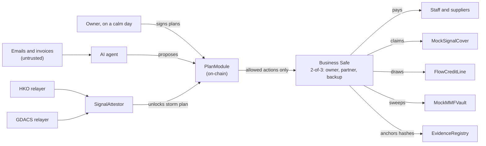

# Signal 8 Wallet (风球钱包)

FinTechathon 2026, International Track, **Topic F (Agent Wallet)**.

An AI treasurer for a small business. It runs the business's money every day from **plans the owner signs in advance**, and switches to a **pre-signed storm plan** the moment an official typhoon signal is raised. The AI reads, forecasts, drafts and explains; smart contracts decide what money may move.

- Live demo: replay of Super Typhoon Ragasa (Hong Kong, 22 to 25 Sep 2025) on **Base Sepolia**.
- Second replay: Typhoon Yagi (Vietnam, 6 to 7 Sep 2024) on a local **FISCO BCOS** chain (stretch goal).
- Submission deadline: **20 Oct 2026, 23:59 Beijing (22:59 Vietnam)**.

## Where things are

| What | Where |
| --- | --- |
| Detailed implementation plan | [docs/PLAN.md](docs/PLAN.md) |
| Contract specs | [docs/specs/contracts.md](docs/specs/contracts.md) |
| Agent, relayer and replay specs | [docs/specs/agent.md](docs/specs/agent.md) |
| Plan book format and hashing | [docs/specs/plans.md](docs/specs/plans.md) |
| Security self-assessment (fill in as we go) | [docs/SECURITY.md](docs/SECURITY.md) |
| Demo script and demo-day checklist | [docs/DEMO.md](docs/DEMO.md) |
| Execution evidence (transaction hashes) | [docs/EVIDENCE.md](docs/EVIDENCE.md) |
| Questions for the organizers | [docs/ORGANIZER_QUESTIONS.md](docs/ORGANIZER_QUESTIONS.md) |
| How we work (branches, PRs, done) | [CONTRIBUTING.md](CONTRIBUTING.md) |
| Task board | Notion: "FinTechathon 2026: hackathon tasks" |

## How it works, in one picture



## Repository layout

```
contracts/   Foundry project (Solidity 0.8.11, OpenZeppelin 4.9): PlanModule, SignalAttestor, mocks
agent/       TypeScript: relayers, replay runner, extractor, planner, executor, everyday loop
web/         Dashboard, plan book page and attack arena (Next.js, read only)
data/        Replay timelines (Ragasa, Yagi) and demo fixtures (invoices, payroll, plans)
redteam/     Attack suite and benchmark harness
docs/        Plan, specs, security self-assessment, demo, evidence
```

## Quick start: the whole demo on a local chain

First iteration: contracts, agent backend and website run end to end on a local Anvil chain. Base Sepolia deployment, the Safe proposal path and the red-team benchmark are next.

Needs Node 22 and [Foundry](https://book.getfoundry.sh/getting-started/installation). No `.env` is needed locally: on Anvil everything uses Anvil's public dev accounts.

```bash
# 1. contracts: build, test, deploy to a local chain
cd contracts
git clone --depth 1 --branch v1.9.7 https://github.com/foundry-rs/forge-std lib/forge-std
git clone --depth 1 --branch v4.9.6 https://github.com/OpenZeppelin/openzeppelin-contracts lib/openzeppelin-contracts
forge test
anvil                                    # in a second terminal
forge script script/Deploy.s.sol --rpc-url http://127.0.0.1:8545 --broadcast   # writes deployments/anvil.json

# 2. agent: tests, then the full Ragasa replay (an ordinary day, then the storm), then the API
cd ../agent
npm install
npm test
npm run replay -- --event ragasa-2025 --speed 100000
npm run serve                            # decision log + arena API on :8787 (third terminal)

# 3. website: dashboard on http://localhost:3000, /plan and /arena
cd ../web
npm install
npm run dev
```

One full replay uses most of a day's caps; run the next one on a fresh `anvil` (and redeploy) or the runner refuses to start.

## Ground rules

1. **No private key ever goes near a model.** The agent backend signs; the model only emits typed actions.
2. **Nothing typed into a chat, email or invoice can widen the agent's authority.** Only signed plans and two-source official signals can.
3. **Every money movement is a transaction hash** we can put in `docs/EVIDENCE.md`.
4. Testnet only. No real funds, no token issuance, no yield promises. Insurer and lender are labelled mocks.
