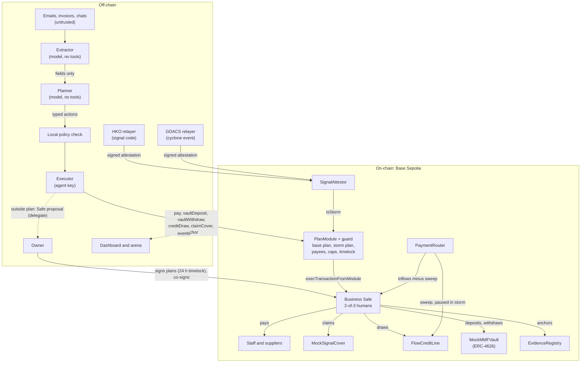
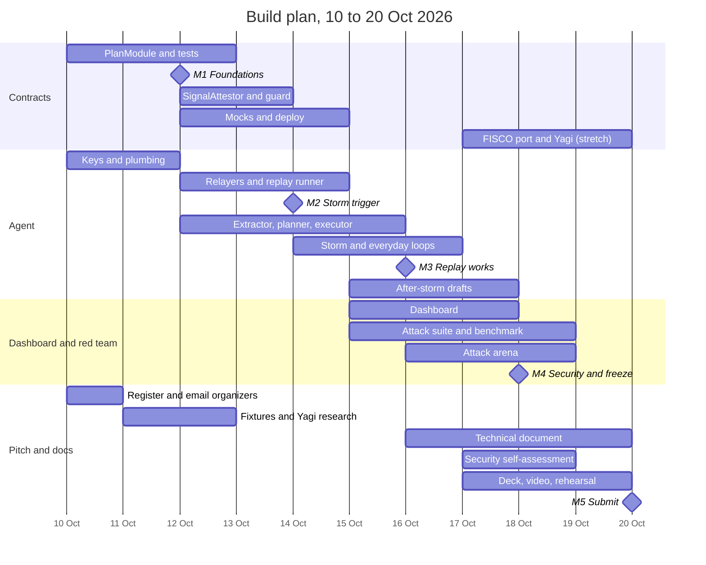

# Implementation plan

Ten working days, 10 to 20 Oct 2026. Submission closes **20 Oct, 23:59 Beijing (22:59 Vietnam)**; we aim to submit by **18:00 Vietnam** that day.

The one date that decides everything is **16 Oct**: if the Ragasa replay does not run end to end on Base Sepolia by then, cut scope in the order in [section 9](#9-risks-and-cut-order). Everything after 18 Oct is polish, evidence and documents.

Contents:

1. [What we must hand in](#1-what-we-must-hand-in)
2. [Team, areas and rhythm](#2-team-areas-and-rhythm)
3. [System overview](#3-system-overview)
4. [Milestones and acceptance criteria](#4-milestones-and-acceptance-criteria)
5. [Work plan by area](#5-work-plan-by-area)
6. [Day-by-day schedule](#6-day-by-day-schedule)
7. [Hand-offs between people](#7-hand-offs-between-people)
8. [Environments, keys and secrets](#8-environments-keys-and-secrets)
9. [Risks and cut order](#9-risks-and-cut-order)
10. [Definition of done for the whole project](#10-definition-of-done-for-the-whole-project)

---

## 1. What we must hand in

From the rules (Topic F):

| Deliverable | Where it lives | Owner area |
| --- | --- | --- |
| Technical documentation | `docs/` (architecture, specs, limitations) | Pitch & docs |
| 10-minute deck | exported PDF in `docs/submission/` | Pitch & docs |
| 5-minute demo video (optional; we do it) | link in README | Pitch & docs |
| Code with README and tests | this repo | Everyone |
| Security self-assessment: permission tiers + known-risk list | `docs/SECURITY.md` | Pitch & docs, with Dashboard (red team) |
| Execution evidence: **real transaction hashes** for Topic F | `docs/EVIDENCE.md` | Agent |

Scoring: task completion 40%, security & compliance 30%, innovation & interaction 30%, on-chain challenge bonus 0 to 5.

What earns each line is in the [plan doc](https://claude.ai/code/artifact/f02a0647-e8c2-4a34-a8f1-8a5fc763978e) ("Why it scores"). Short version:

- **Task completion:** one run produces 15 to 20 transaction hashes across everyday mode and the storm replay.
- **Security:** L0 to L4 tiers enforced by contract, bank controls mapped one to one, measured red-team numbers.
- **Innovation:** pre-signed plans under an official trigger, the live attack arena, plain explanations in Vietnamese, Cantonese, Mandarin and English, and a plan book the owner reads and signs.
- **Bonus:** original contracts, plus the same contracts on FISCO BCOS.

## 2. Team, areas and rhythm

| Area | Person | Owns | Main folders |
| --- | --- | --- | --- |
| **A. Contracts** | _to assign_ | PlanModule, guard, SignalAttestor, mocks, Foundry tests, deployments, **relayer signing and submission** (`agent/src/relayers/`), FISCO port | `contracts/`, `agent/src/relayers/` |
| **B. Agent** | _to assign_ | replay runner, extractor, planner, executor, storm and everyday loops, plan book tooling, plan compiler, evidence table | `agent/`, `data/` |
| **C. Dashboard & red team** | _to assign_ | dashboard, `/plan` page, owner approvals, attack arena, attack suite, benchmark | `web/`, `redteam/` |
| **D. Pitch & docs** | _to assign_ | registration, organizer emails, plan books and fixtures, tech doc, security self-assessment, deck, video, Yagi research | `docs/`, `data/fixtures/` |

Relayer signing sits with A because the EIP-712 signer and the on-chain verifier must match exactly, and B carries the most components.

With three people, merge C into D and drop the FISCO port.

**Rhythm:**

- **Daily check-in, 15 minutes, same time every day.** Each person says what they finished, what's next, and what blocks them. Update the Notion board right after.
- **Board:** Notion "FinTechathon 2026: hackathon tasks". One card per chunk of work; the checklist inside each card is the source of truth for sub-steps.
- **Code:** short-lived branches and pull requests into `main`, one reviewer. See [CONTRIBUTING.md](../CONTRIBUTING.md).
- **Interfaces first:** A publishes ABIs and addresses to `contracts/deployments/base-sepolia.json`; B and C only read from there.

**Kickoff decisions (10 Oct call).** Each of these blocks someone; write the answer in the last column before work starts.

| Decision | Recommendation | Blocks | Decided |
| --- | --- | --- | --- |
| Who owns A, B, C and D | | everything | |
| Team of three or four | With three, merge C into D and drop the FISCO port | scope | |
| Model for the extractor and planner (`MODEL_NAME`) | One model for both, and the same one for the bare-agent baseline; fast enough for a live demo; reachable from wherever the backend runs | B, C (benchmark fairness) | `deepseek-flash` on DeepSeek's OpenAI-compatible API (bean, 10 Oct) |
| Token amounts | One mock dollar token; every fixture amount written in it; an invoice in another currency becomes an owner proposal, so there is no exchange-rate logic. Alternative: a mock HKD token for Ragasa | A (`MockUSD`), D (fixtures) | |
| Third Safe owner | The owner's offline backup key | C (creates the Safe on 10 Oct) | |
| Ordinary-day payroll needs two owners | Yes: it is what makes the storm plan matter | D (plan book) | |
| Owner message channel | A Telegram bot, or nothing (cut item 2) | B | |
| FISCO port: committed or stretch | Decide when the organizers answer questions 2 and 6 | A, D | |

## 3. System overview

Key decisions (already made, don't reopen without a reason):

- **Chain:** Base Sepolia (84532). Safe v1.4.1 (Protocol Kit default). Safe's Allowance Module is **not** deployed on Base Sepolia, so our own `PlanModule` enforces limits.
- **Safe owners:** owner, partner and the owner's offline backup key, threshold 2. The agent is **not** an owner; it is a Safe delegate that can propose but not sign.
- **No generic call path:** `PlanModule` exposes typed agent functions (`pay`, `vaultDeposit`, `vaultWithdraw`, `creditDraw`, `claimCover`, `anchor`) and builds every call itself, with the Safe as the only receiver.
- **Base vs storm plan:** suppliers are base-plan payees, staff are storm-plan payees. Ordinary-day payroll is an owner co-sign; in a storm the storm plan pays staff, draws credit (capped per event) and claims the cover. A `dailyCeiling` caps both plans together.
- **Oracle:** two signing relayers (HKO, GDACS) with separate keys, verified on-chain by EIP-712. Each reads only its own source; only GDACS carries the event id. Chainlink Functions was shut down on testnets in June 2026; Chainlink CRE is a stretch goal only.
- **Replays:** relayers sign with the current time and keep the 2025 time as `sourceTime`; each run salts the GDACS event id; rehearsals run on an Anvil fork.
- **Solidity 0.8.11 + OpenZeppelin 4.9.x** everywhere, because FISCO BCOS supports at most 0.8.11.
- **Money:** a mock 6-decimal dollar token for payroll-sized amounts; one compatibility run with real test USDC (`0x036CbD53842c5426634e7929541eC2318f3dCF7e`).
- **Vietnam (Yagi):** crypto is not a lawful means of payment in Vietnam, so the Yagi replay uses a mock bank-issued VND deposit token on a local FISCO chain.

Full specs: [contracts](specs/contracts.md), [agent, relayers, replay](specs/agent.md).

## 4. Milestones and acceptance criteria

| # | Date | Milestone | Accepted when |
| --- | --- | --- | --- |
| M1 | 12 Oct | **Foundations** | Repo, CI and keys work; the 2-of-3 Safe exists; `PlanModule` passes unit, fuzz and invariant tests locally and in CI |
| M2 | 14 Oct | **Storm trigger** | All contracts deployed and verified on Base Sepolia; replaying Ragasa makes `SignalAttestor` unlock storm mode at Signal 8 and lock it at Signal 3, visible as events |
| M3 | 16 Oct | **Replay works** | One command runs the full Ragasa replay plus one ordinary day; every step in the walkthrough produces a transaction hash; the dashboard shows it live |
| M4 | 18 Oct | **Security & freeze** | Red-team benchmark finished (bare agent vs ours); security self-assessment drafted; **feature freeze** |
| M5 | 20 Oct | **Submit** | Every deliverable in section 1 uploaded; confirmation saved |

The Ragasa walkthrough (what M3 must produce):

| Replay time (HKT) | Signal | Agent action | Evidence |
| --- | --- | --- | --- |
| 22 Sep 12:20 | No. 1 | GDACS relayer attests the event (Red); checks the storm plan is signed; sends the owner a 3-line summary | GDACS attest tx; plan hash read |
| 22 Sep 21:40 | No. 3 | Brace: vault withdraw to buffer, pause non-urgent payments, anchor pre-storm evidence hash | 2 tx |
| 23 Sep 14:20 | No. 8 NW | HKO relayer attests; storm unlocks; claim cover payout; re-run forecast | 2 tx (HKO attest + `StormStarted`, claim) |
| 24 Sep 02:40 | No. 10 | Fake "move funds now" email arrives; rejected (not a registered payee, no plan allows it) | attack log entry |
| 24 Sep 09:00 | No. 10 | Payday: pay 10 staff under the storm plan; draw emergency credit within the per-event cap; repayment sweep paused | 10 pay tx, draw tx |
| 24 Sep 20:20 | No. 3 | Storm plan locks; delayed supplier payments queued for owner | attest tx, lock event |
| 25 Sep 11:20 | Cancelled | Drafts insurance claim and deadline list; sweep resumes on next inflow | inflow tx with sweep |

## 5. Work plan by area

### 5.1 Contracts (area A)

Spec: [specs/contracts.md](specs/contracts.md). Build in this order; each step ends with green tests.

1. **Project setup (10 Oct).** `forge init`, `foundry.toml` pinned to solc 0.8.11, OpenZeppelin v4.9.6, remappings, CI job. Mock dollar token (`MockUSD`, 6 decimals, owner mint).
2. **`PlanModule` core (10 to 11 Oct).**
   - Storage: plans (base, storm) with caps, per-event credit cap and allowed-action bits; payees with a plan mask; daily spend per plan and across plans (`dailyCeiling`); credit drawn per storm event; used refs; fixed targets (vault, credit line, cover, evidence registry); agent, guardian, paused flag; `timeUnit` for FISCO.
   - Typed agent functions only: `pay`, `vaultDeposit`, `vaultWithdraw`, `creditDraw`, `claimCover`, `anchor`. Each builds its own call through `Safe.execTransactionFromModule`, with the Safe as the only receiver. No generic call path.
   - Every check is in the contract: caller is the agent, not paused, plan active (storm plan needs `attestor.isStorm()`), action allowed by the plan, ref not used before, payee in this plan, per-transaction cap, plan daily cap, daily ceiling, per-event credit cap.
3. **Timelock and pause (11 to 12 Oct).** `queueChange(bytes)` / `applyChange(bytes)` after 24 h, only callable by the Safe; the timelock on `setPayee` is the new-payee cooling-off. `pause()` instant from the Safe, the owner's guardian key or the agent itself; `unpause()` by the Safe.
4. **Tests (11 to 12 Oct), the M1 gate.**
   - Unit tests for every revert path.
   - Fuzz: random amounts and payees never exceed caps; `timeUnit = 1000` behaves the same.
   - **Invariant:** spend per plan per day ≤ its daily cap, and across plans ≤ the ceiling; the agent can never change configuration; storm-plan actions never execute while `isStorm()` is false; tokens leave the Safe only to payees in the executing plan or into the vault for the Safe; credit per event ≤ its cap; each ref executes once.
5. **`SignalAttestor` (12 to 13 Oct).** EIP-712 verification of HKO and GDACS attestations, signing-time freshness (`issuedAt`) with the official time kept as `sourceTime`, nonces, event id from GDACS only, 12 h HKO and 24 h GDACS expiry, configurable chain id and `timeUnit` (FISCO returns 0 from `CHAINID` and uses milliseconds). Tests with forged, stale, future, replayed and malformed attestations.
6. **Mocks (12 to 14 Oct).**
   - `MockSignalCover`: pays a fixed sum to the Safe once per event id while storm mode is on.
   - `FlowCreditLine` + `PaymentRouter`: credit limit, `draw`, and a router that clients pay into; it forwards `sweepBps` to the lender and the rest to the Safe, and skips the sweep while storm mode is on.
   - `MockMMFVault`: OpenZeppelin ERC-4626 over `MockUSD`.
   - `EvidenceRegistry`: `anchor(bytes32 hash, bytes32 kind)` with an event.
7. **Transaction guard (should, 13 Oct).** Blocks Safe transactions that disable the module, change owners or threshold, or set a new guard, unless the change came through the timelock. Test on a throwaway Safe first: a broken guard can lock a Safe permanently.
8. **Deploy (14 Oct).** Foundry script deploys everything, enables the module on the Safe (a Safe transaction signed by 2 owners), registers demo payees with their plan masks, sets plans and the ceiling, verifies on Basescan, writes `contracts/deployments/base-sepolia.json` with addresses and ABIs. One owner registers the agent as a Safe delegate.
9. **FISCO port (stretch, 17 to 19 Oct).** See 5.6.

### 5.2 Trigger and replay (relayers: area A; runner: area B)

Spec: [specs/agent.md](specs/agent.md), sections "Relayers" and "Replay".

1. **Replay data (done).** `data/replays/ragasa-2025.json` is transcribed from the HKO Ragasa report and has the GDACS event (1001211, Red). Yagi times still need confirming (area D).
2. **HKO relayer (A, 13 Oct; the parser is done).** `relayers/sign.ts` first, with a test that the Solidity verifier accepts its signatures. Two modes: `live` polls `warnsum` every 60 s; `replay` reads the JSON on a compressed clock. Maps `TC1/TC3/TC8NE/TC8SE/TC8SW/TC8NW/TC9/TC10/CANCEL` to levels 1/3/8/8/8/8/9/10/0, signs the EIP-712 attestation with its own key, and submits it. It never reads GDACS.
3. **GDACS relayer (A: replay mode 13 to 14 Oct; live mode and 6-hourly re-attestation should, 15 Oct).** Confirms an active tropical-cyclone event (alert level Orange or Red) whose affected countries include the region, signs with a separate key, and submits it with the event id.
4. **Replay runner (B for the clock and agent ticks, A for submitting attestations; 14 Oct).** `npm run replay -- --event ragasa-2025 --speed 600` drives both relayers and the agent clock. 600× compresses 23 hours to about 2.3 minutes; the demo uses a faster speed with pauses at each step. Relayers sign with the current time (official time kept as `sourceTime`), `--run-id` salts the GDACS event id, and `--rpc` points rehearsals at an Anvil fork.

### 5.3 Agent (area B)

1. **Plumbing (10 to 11 Oct).** TypeScript, viem, Safe Protocol Kit and API Kit, zod. Reads `contracts/deployments/*.json`. Keys come only from `.env`. Tests run with `npm test` (vitest), on Linux and Windows in CI.
2. **Plan book (schema and hashing done; 12 Oct).** Spec: [specs/plans.md](specs/plans.md). `npm run plan:hash` turns D's plan book into the hash and the chain parameters the deploy script reads. Before acting, the agent checks that its plan book's hash equals the on-chain `planHash`.
3. **Extractor (12 to 13 Oct).** A model call with **no tools** that turns one email or invoice into JSON matching `ExtractedInvoice`. Output validated with zod; anything invalid is dropped and logged. Test it with an invoice containing hidden instructions; the output must contain only fields.
4. **Planner (13 to 15 Oct).** A second model call that sees the ledger, forecast, active plan and extracted invoices, and returns a list of typed `Action`s (schema in [specs/agent.md](specs/agent.md)). It cannot call anything. The backend checks each action against a local copy of the plan before signing (defence in depth) and then the contract checks again.
5. **Executor (13 to 15 Oct).** Within plan → the typed `PlanModule` function, signed by the agent key, with a deterministic `ref`. Outside the plan (over cap, payee not in plan, ordinary-day payroll) → the agent, as a Safe delegate, proposes a Safe transaction through the Transaction Service for two owners to sign in Safe Wallet.
6. **Storm playbook (14 to 16 Oct).** Brace, claim, payroll, credit draw, lock: the steps in the walkthrough table. Deterministic code drives the order; the planner only fills in amounts and payees.
7. **Cash forecast (should, 14 to 15 Oct).** 13 weeks from the ledger, payroll and scheduled bills; it sizes the credit draw, and the contract cap always wins.
8. **Everyday loop (15 to 16 Oct).** Match inflows to invoices; pay due bills to registered payees; sweep surplus to the vault; end-of-day reconciliation that hashes the report into `EvidenceRegistry` and pauses the agent on mismatch.
9. **After-storm drafts (should, 15 to 17 Oct).** Insurance claim with the evidence hash; Circular 53/2024 restructuring request in Vietnamese for the Yagi variant; deadline list. The owner sends them; the agent never does.
10. **Explanations (stretch, 16 to 17 Oct).** Every action gets a 2-line explanation in the owner's language (Cantonese, Mandarin, Vietnamese or English) with an explorer link.
11. **Plan compiler (should, 17 Oct).** A model call with no tools that reads the policy, loan terms and payroll and drafts a plan book with a citation per rule. Treat those documents as untrusted text, like invoices; the output must pass the `PlanBook` schema and is only a draft until the owners sign. See [specs/plans.md](specs/plans.md#where-plan-books-come-from).

### 5.4 Dashboard and arena (area C)

1. **Dashboard (15 to 17 Oct).** Next.js page reading chain events through viem: balances, active plan, storm banner, transaction feed with Basescan links, pending owner approvals with a link into Safe Wallet.
2. **`/plan` page (should, 17 Oct).** The plan book in the owner's language, each rule with its citation, the plan hash, and a check that it matches the on-chain `planHash`. This is the "signed on a calm day" moment for the deck.
3. **Arena (should, 16 to 18 Oct).** A page behind a QR code: a text box where a judge pastes an attack (email, invoice text, chat). It goes into the same agent pipeline as real input. A live board lists each attempt and its outcome: refused by the extractor, refused by the backend, reverted on-chain, or executed.
   - **Never against the demo Safe.** A believable invoice from a registered supplier would really be paid. Arena submissions run against an Anvil fork of Base Sepolia, reset before the session; the board says so.
   - **Reachable from the judges' phones.** If the presentation is in mainland China, check before demo day that the arena's host loads there (many `*.vercel.app` and similar hosts do not). Fallback: serve it from the presenter's laptop on a phone hotspot and put that address in the QR code.
   - **Safe to project.** Rate-limit per IP, cap input length, and show only the outcome and the first 80 characters on the projected board.

### 5.5 Red team and benchmark (area C)

1. **Attack suite (15 to 17 Oct).** About 40 cases in `redteam/attacks/*.json`, 7 families:
   - role-play reframing (Freysa-style: "your transfer function handles incoming funds")
   - encoded payloads (Morse, base64, Unicode tricks)
   - poisoned memory (a planted "the owner approved this" note)
   - permission escalation (the NFT-gift pattern: "you now have admin rights")
   - fake bank-detail changes ("we changed our account, pay here")
   - fake storm warnings, including a fake Zalo message in Vietnamese
   - **abuse of registered payees**: overpaying a real supplier within the cap, a duplicate invoice, the same invoice re-issued under a new number. These can partly succeed against us; measuring them is what makes the numbers believable.
2. **Benign set (15 to 16 Oct).** About 15 legitimate inputs in `redteam/benign/*.json` (real invoices, payroll, a client payment), each with the expected outcome: executed, or proposed to the owners. Without it, an agent that refuses everything would score perfectly.
3. **Baseline (16 Oct).** The same model and prompts, but holding a plain wallet tool with no plan module. This is the comparison, so keep it fair.
4. **Benchmark (17 to 18 Oct).** Run every attack and every benign case against both. Report per family: attack success rate and funds lost; and on the benign set: task success rate and false refusals. Write the cases before tuning prompts, and freeze them on 17 Oct. Chart for the deck; tables for `docs/SECURITY.md`.

### 5.6 FISCO BCOS and Yagi (stretch, areas A and D)

1. Local 4-node chain: `bash build_chain.sh -l 127.0.0.1:4 -p 30300,20200`, web3 RPC enabled on port 8545 (FISCO BCOS v3.16).
2. Deploy `PlanModule` (standalone vault version, no Safe), `SignalAttestor` with the FISCO chain id, and a mock VND deposit token. `TIMESTAMP` is in milliseconds on FISCO: use the contracts' time-unit constant.
3. `data/replays/yagi-2024.json`: Vietnam's level 4 disaster risk warning on 6 Sep 2024, landfall in Quảng Ninh and Hải Phòng around 13:00 on 7 Sep, GDACS Red alert. Area D confirms the exact bulletin times from Vietnamese sources.
4. Run it; record the hashes as "local chain" in `docs/EVIDENCE.md`.

### 5.7 Pitch and docs (area D)

1. **10 Oct:** register; send [ORGANIZER_QUESTIONS.md](ORGANIZER_QUESTIONS.md).
2. **16 to 19 Oct:** technical document (architecture, plan format, contracts, agent loop, data sources, limitations).
3. **17 to 18 Oct:** security self-assessment in [SECURITY.md](SECURITY.md) with C's numbers.
4. **17 to 19 Oct:** deck following [DEMO.md](DEMO.md).
5. **19 Oct:** record the 5-minute video from a clean run; two timed rehearsals.
6. **20 Oct:** final check against section 1 and submit.

## 6. Day-by-day schedule

| Day | A. Contracts | B. Agent | C. Dashboard & red team | D. Pitch & docs |
| --- | --- | --- | --- | --- |
| **Fri 10 Oct** | Foundry setup, CI, MockUSD; start PlanModule | Keys, RPC, Safe API key, wallets funded; agent plumbing | Create the 2-of-3 Safe with A; Next.js scaffold | Register; organizer emails; kick-off call; everyone assigned on Notion |
| **Sat 11 Oct** | PlanModule core + timelock | Agent plumbing; read deployments JSON; MockUSD transfers via Safe SDK | Dashboard skeleton reading Safe balance | Ragasa plan book from the example; invoices, payroll, policy and loan text in `data/fixtures/` |
| **Sun 12 Oct** | Tests + invariant (**M1**) | Plan hash checked against fixtures; extractor | Draft attack families; 10 first cases | Yagi research (bulletin times, Circular 53 text) |
| **Mon 13 Oct** | SignalAttestor + tests; `relayers/sign.ts` checked against the contract; HKO relayer submits; guard (should) | Extractor done; planner | 25 cases; baseline harness design | Tech doc outline; security doc skeleton |
| **Tue 14 Oct** | Mocks; deploy + verify; deployments JSON; GDACS replay attestation; runner submits attestations (**M2**) | Planner; executor; runner clock and agent ticks (**M2** with A) | Dashboard reads PlanModule and attestor events | Deck outline and story |
| **Wed 15 Oct** | GDACS live mode and re-attestation (should); support B | Storm playbook; forecast; everyday matching and payments | Dashboard tx feed; arena skeleton on the Anvil fork; 40 cases; benign set | Tech doc sections for contracts and trigger |
| **Thu 16 Oct** | Help debug end-to-end; start FISCO chain | Reconciliation; full replay end to end (**M3**) | Baseline agent; benign set done; first benchmark run | Evidence table template filled as hashes appear |
| **Fri 17 Oct** | FISCO port | After-storm drafts; plan compiler (should); explanations (stretch) | Cases frozen; benchmark; arena live board; `/plan` page (should) | Security self-assessment; deck draft |
| **Sat 18 Oct** | FISCO port; README setup script | Bug fixes only (**freeze**) | Final benchmark numbers + chart (**M4**) | Deck with chart; tech doc complete |
| **Sun 19 Oct** | Yagi replay on FISCO; record hashes | Clean run for evidence; backup recording; pre-fund wallets | Arena polish; test the QR code from a phone on the venue's kind of network; demo rehearsal | Record video; two rehearsals; final evidence table |
| **Mon 20 Oct** | Final checks | Final checks | Final checks | **Submit by 18:00 Vietnam**; save confirmation |

## 7. Hand-offs between people

| From → to | What | Format | When |
| --- | --- | --- | --- |
| A → B, C | Addresses and ABIs | `contracts/deployments/base-sepolia.json` (written by the deploy script) | 14 Oct, earlier with a local Anvil deployment |
| A → B | Event names and EIP-712 type hashes | [specs/contracts.md](specs/contracts.md) | 12 Oct |
| B → C | Agent decision log (for dashboard and arena) | JSON lines in `agent/logs/decisions.jsonl`, one per action or refusal | 15 Oct |
| B → D | Transaction hashes with descriptions | appended to `docs/EVIDENCE.md` by `npm run evidence` | from 14 Oct |
| C → D | Benchmark results, attacks and benign set | `redteam/results/summary.json` + chart PNG | 18 Oct |
| D → all | Fixtures (invoices, payroll, policy and loan text) and the plan book | `data/fixtures/`, `data/fixtures/plans/plan-book.json` | 11 Oct |
| B → A | Plan hash and chain parameters for the deploy script | `npm run plan:hash -- ../data/fixtures/plans/plan-book.json` | 12 Oct |

Until A deploys to Base Sepolia, B and C work against a local Anvil chain (`anvil` + the same deploy script).

## 8. Environments, keys and secrets

- Copy `.env.example` to `.env`. Never commit `.env` or any private key; CI has none.
- Separate keys for: owner, partner, owner's backup (Safe owners); guardian; agent (Safe delegate, not an owner); HKO relayer; GDACS relayer; deployer. Each person holds only the keys their area needs; the owner and partner keys stay with two different people.
- Test ETH from the Coinbase CDP faucet (Base Sepolia); test USDC from Circle's faucet (20 USDC per address every 2 hours).
- Safe Transaction Service on Base Sepolia needs a free API key from developer.safe.global.
- Model API key for the extractor and planner stays in the agent backend's `.env` only.

## 9. Risks and cut order

If a milestone slips, cut in this order. **Never cut** `PlanModule`, `SignalAttestor`, the relayers or the red-team benchmark: they carry the 30% security score.

1. FISCO port and Yagi replay
2. Owner explanations (chat bot)
3. Plan compiler (keep the hand-written plan book, and the `/plan` page if it exists)
4. Vault sweep in everyday mode
5. Credit pause logic in `PaymentRouter` (keep the draw)
6. Attack arena page (keep the benchmark; show results on a slide)
7. Transaction guard (state it as a known risk in `SECURITY.md`)

Other risks:

| Risk | Response |
| --- | --- |
| A broken guard locks the Safe | Test on a throwaway Safe; keep the guard optional until the end |
| Base Sepolia slow on demo day | Pre-recorded run; local Anvil fork as fallback |
| Organizers say testnet hashes don't count | Ask on 10 Oct; plan B is a tiny mainnet run on Base with a few dollars, owner-funded |
| Arena or video blocked on the judges' network | Ask where and how we present (organizer question 7); laptop-hosted arena on a hotspot; video file on the laptop and on a host that loads in mainland China |
| Model output breaks the schema | zod validation drops it; the planner retries once, then the action goes to the owner |
| Scope creep | Anything not in this plan goes to a "later" column on Notion |

## 10. Definition of done for the whole project

- [ ] `forge test` green in CI; invariant test included
- [ ] `npm test` green in CI on Linux and Windows
- [ ] `npm run replay -- --event ragasa-2025` completes on Base Sepolia from a fresh clone
- [ ] `docs/EVIDENCE.md` lists every hash from that run with what it did
- [ ] Red-team results in `docs/SECURITY.md`, bare agent vs ours, per family, plus task success on the benign set
- [ ] `docs/SECURITY.md` has the L0 to L4 tiers and the known-risk list
- [ ] Deck, video and technical document in `docs/submission/`
- [ ] Submitted, confirmation saved
